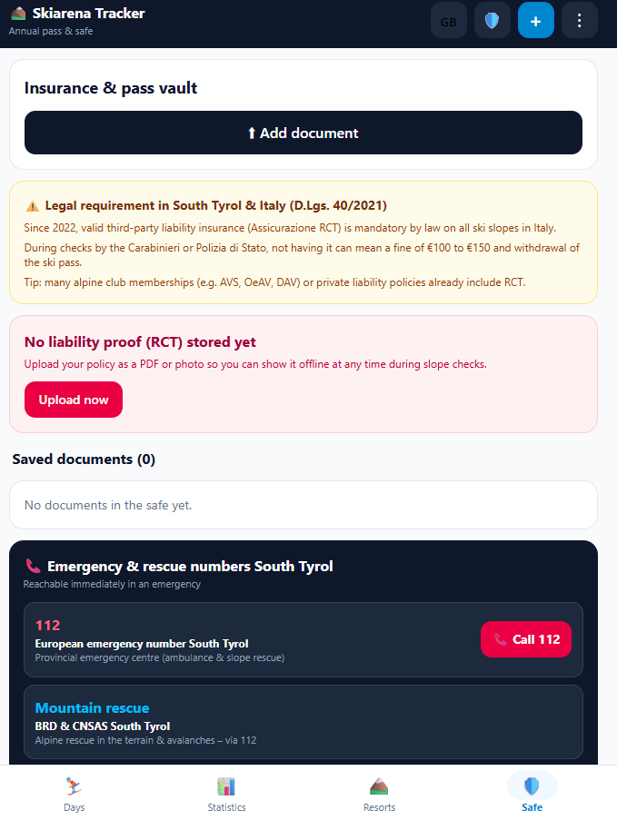

# Skiarena-Tracker

An app for ski pass holders – **Südtirol Skiarena**, **Dolomiti Superski**, **Zillertal Superskipass** or your own pass. Log your mountain days and see when your pass has paid for itself. Your liability insurance certificate is always at hand, even offline.

**Android:** [download the latest APK](../../releases/latest) · **iPhone:** [egazzz.github.io/skiarena-tracker](https://egazzz.github.io/skiarena-tracker/)

> **Unofficial app.** It is not provided by any ski pass network and is not affiliated with any lift operator. All information is provided without guarantee.

  
  
  
  

---

## Features

- **Ski passes as profiles.** Each profile is one ski pass network with its own mountain days, pass years and prices: Südtirol Skiarena (18 resorts), Dolomiti Superski (12 areas), Zillertal Superskipass (5 areas) or a custom pass with your own resorts. Switch by tapping the profile name at the top. Document safe and travel settings are shared.
- **Log mountain days.** Pick the resort, activity (skiing, ski touring, tobogganing, hiking, biking), lift use and date. "Today like last time" adds a day with one tap.
- **Pass payback.** Each day is valued at what it would have cost without the pass. Prices come from a configurable price table, with optional per-resort prices and per-entry overrides. You see how much is left until the pass has paid off, or how much you have saved.
- **Pass years.** Each pass year has its own period and price. Statistics are calculated per year, with a year-to-year comparison.
- **Travel, fuel & CO₂.** Set your home town, drive type (petrol, diesel, LPG, electric) and consumption once. For each mountain day you choose how you got there: car, car pool, public transport or without a car. The app estimates kilometres, fuel costs and CO₂ – and the CO₂ you saved. Road distances to all resorts are looked up once via OpenStreetMap and can be adjusted. The fuel price is set per pass year.
- **Extra costs.** Track extras such as bike transport or a dog. They appear as a separate total and are not counted towards the payback.
- **Statistics.** Value by sport, winter/summer split, and an explorer list of all 18 resorts with your visits.
- **Resorts.** All resorts of the selected pass with key figures, webcam links and your own visit history. Add your own resorts at any time.
- **Document safe and slope check.**
  - Store your ski liability insurance (RCT, mandatory in Italy under D.Lgs. 40/2021) as a PDF or photo. The legal notice is shown for passes with resorts in Italy.
  - Show it during a check in Italian, offline and full screen.
- **Backup.**
  - Manual export and import, so you can move to a new phone.
  - Android only: automatic backup to a folder of your choice, e.g. Google Drive.
  - Backup files work on both Android and iPhone.
- **Settings in one place.** Tap ⚙️ at the top right for language, ski passes, costs, travel, backup, updates and help.
- **Easy to read.** Choose a font (standard, the highly legible *Atkinson Hyperlegible*, rounded or serif) and an app size of 100 %, 115 %, 125 % or 150 % – text, buttons and spacing grow together.
- **Only what you need.** Optional fields (value and extra costs, fuel price, insurance details) can open automatically when filled in, always stay open, or stay collapsed.
- **Three languages.** German, Italian and English. The app follows your system language by default, or you can pick one in the settings.
- **Updates.** The Android app checks this repository's releases and installs new versions on request. The iPhone version updates itself automatically.
- **Diagnostic report (Android).** Share technical details and an error log to help fix problems. It contains no personal data.

## Installation

### Android

1. Download the latest `.apk` from [Releases](../../releases/latest).
2. Open it on your phone. If Android asks, allow installing apps from this source.
3. Done. Future updates are offered directly in the app when it starts (this can be turned off in ⚙️ Settings).

**Requirements:** Android 5.0 (API 21) or newer.

### iPhone (and any browser)

1. Open **https://egazzz.github.io/skiarena-tracker/** in **Safari** (if you got the link in WhatsApp, long-press it → *Open in Safari*).
2. Tap **Share** → **Add to Home Screen** → **Add**.
3. The tracker now starts like an app and also works offline. Updates load automatically when you open it with an internet connection.

The iPhone version has the same features as the Android app, with a few differences:

- No automatic backup. Save a backup file regularly via ⚙️ Settings → *Backup*, e.g. to iCloud Drive.
- During a slope check the screen stays on, but the app cannot raise the brightness.
- No app shortcuts, no diagnostic report.

> **Switching phones or reinstalling?** Restore your backup first. On first start, the app offers to restore from a backup file. Backups can be moved between Android and iPhone.

## Privacy

- All data (days, settings, documents) is stored **only on your device**. There is no account, no cloud server and no tracking.
- The Android app uses the internet **only** to check this repository for new releases (GitHub API), to download updates and – when you set your home town – once to look up the place and the road distances via OpenStreetMap (Nominatim, OSRM). Only the place name you type and its coordinates are sent.
- On Android, automatic backups are written only to the folder you choose.
- On iPhone, all data stays in the browser storage on your device. If you clear Safari's website data, it is gone – keep a backup.
- The diagnostic report is created only when you request it, and you decide where to send it. It contains no days, resorts or documents.

### Permissions (Android)

| Permission | Why |
|---|---|
| Internet | Checking for and downloading updates |
| Install apps | Installing downloaded updates (Android asks once) |

The iPhone version needs no permissions.

## Release notes for maintainers

- **Android:** New versions are published as GitHub releases with the tag `v` + version name (e.g. `v1.8.1`) and the `.apk` attached. Do not mark them as pre-release. The app checks the latest release for updates and shows its release notes.
- **iPhone/web:** Served from the `docs/` folder via GitHub Pages (branch `main`, folder `/docs`). To update, replace the contents of `docs/` with the new build and keep the empty `docs/.nojekyll` file.

## Credits

- Fonts [Atkinson Hyperlegible](https://www.brailleinstitute.org/freefont/) (Braille Institute) and [Nunito](https://github.com/googlefonts/nunito), both under the SIL Open Font License 1.1.
- Maps and distances: © [OpenStreetMap](https://www.openstreetmap.org/copyright) contributors, [OSRM](https://project-osrm.org/).

## Support

The app is free, with no ads and no tracking. I build it in my spare time. If you like it, you can [buy me a coffee on Ko-fi](https://ko-fi.com/egazzz) ☕ – you can pay by card, Apple Pay or Google Pay, no sign-up needed. In the app: ⚙️ Settings → *Support the app*.

## Feedback

Found a bug? On Android, send a diagnostic report from the app (⚙️ Settings → *Send diagnostic report*), or open an [issue](../../issues).
